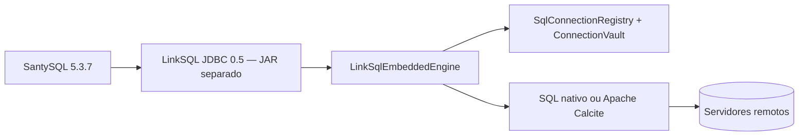

# 02. Arquitetura do sistema

## As camadas que já existem

| Camada               | Classes centrais                                                                                                          | Responsabilidade                                                           |
| -------------------- | ------------------------------------------------------------------------------------------------------------------------- | -------------------------------------------------------------------------- |
| Entrada e controle   | `Main`                                                                                                                    | Estado das abas, eventos, comandos, tarefas de UI, coordenação de execução |
| Aparência            | `LinkSqlVisualStyle`, `LinkSqlDialogStyle`                                                                                | Cores, ícones, espaçamentos, componentes Swing                             |
| Conexões e segurança | `ConnectionManagerDialog`, `SqlConnectionRegistry`, `JdbcConnectionProfile`, `SqlDatabaseType`, `ConnectionVault`         | Configuração, descoberta, pool, senha protegida                            |
| Planejamento SQL     | `SqlTabRouting`, `NativeSqlRouter`, `SingleServerSqlRouter`, `SqlQueryPlanner`, `FederatedQuerySupport`                   | Selecionar uma origem ou delegar para federação                            |
| Federação            | Apache Calcite, `FirebirdCompatDialect`, registro JDBC                                                                    | Coordenar consultas entre origens e adaptar SQL de Firebird                |
| Paginação e modelos  | `NativeJdbcPaging`, `NativeServerPaging`, `NativeQueryCount`, `FederatedCountSupport`, `SqlResultModels`, `SqlPageTotals` | Limites e offset, contagem e montagem de grade                             |
| Editor               | `SqlCompletionContext`, `SqlAutocompleteHints`, `SqlEditorActions`, `SqlEditorShortcutSupport`, `SqlScriptText`           | Edição e análise contextual leve                                           |
| Estado e históricos  | `SqlSessionStore`, `LinkSqlPaths`, `SqlHistoryDialog`, `SqlHistoryStore`, `SqlFavoritesStore`, `LinkSqlSettings`           | Sessão, caminhos, consultas e preferências                                 |
| Exportação           | `CsvExportWriter`                                                                                                         | Serializar dados carregados como CSV                                       |

## Integração JDBC independente

O driver embutido usa a URL `jdbc:linksql:embedded`; não requer abrir a janela LinkSQL nem executar Gateway. O bundle JDBC 0.5, porém, **não é gerado nem substituído automaticamente por este ZIP desktop**. A segurança das credenciais DPAPI exige executar sob o mesmo usuário Windows que as protegeu.

### Nomenclatura e integração 3.3.1

O pacote Java principal agora é `br.com.linksql`. O perfil local principal é `.linksql`; uma cópia compatível dos perfis e do cofre protegido permanece em `.santysql-studio` para o JDBC 0.5 distribuído. O gerador JDBC foi adaptado para preparar uma futura versão 0.6, sem substituir a versão estável automaticamente.
